# Cubrí Seguros

Checkout responsive para contratar un seguro de celular, realizado con HTML, Tailwind CSS v4, Basecoat UI y JavaScript vanilla.

## Cómo ejecutarlo

El proyecto carga los planes de `data/planes.json` con `fetch`, por lo que hay que servirlo por HTTP; no se debe abrir `index.html` directamente con `file://`.

Desde esta carpeta, ejecutá:

```powershell
python -m http.server 8000
```

Después abrí [http://localhost:8000](http://localhost:8000). También se puede usar la extensión Live Server de VS Code. Los estilos de Basecoat, Tailwind y la tipografía Inter se cargan desde CDN, así que se necesita conexión a Internet.

## Flujo implementado

1. Inicio y catálogo de seguros.
2. Equipo: marca, modelo, valor y antigüedad.
3. Plan: Básico, Plus y Premium.
4. Datos personales y aceptación de términos.
5. Pago simulado.
6. Confirmación con póliza.
7. Error de pago, reintento y cambio de medio de pago.

El estado de la contratación vive en `solicitud`. Los planes se obtienen del JSON local; las validaciones muestran errores en línea y las cuotas se calculan con la fórmula de la consigna. No hay backend ni pagos reales. Tras la aprobación simulada se puede descargar una constancia de póliza en HTML, preparada para imprimir o guardar como PDF desde el navegador.
El valor del equipo se muestra con separadores de miles locales (por ejemplo, `$ 600.000`) y se convierte a número antes de calcular las cuotas. El DNI se muestra con puntos (por ejemplo, `46.520.445`) y el celular con el formato de la consigna (por ejemplo, `11 5555-1234`); el estado conserva los dígitos sin separadores.
El medio de pago se elige con tarjetas visuales de crédito o débito. El número de tarjeta se agrupa de cuatro en cuatro, el vencimiento completa la barra automáticamente y el CVV acepta solo dígitos y se oculta al escribir. El tema visual se puede alternar entre modo claro y oscuro desde el encabezado; la preferencia queda guardada en el navegador.

## Recursos y mapeo de componentes

Las siete vistas de la consigna corresponden a los estados `data-paso="0"` a `data-paso="6"` de `index.html`: inicio, equipo, planes, datos personales, pago, confirmación y pago rechazado. Se usa el mismo HTML y JavaScript en mobile y desktop; el resumen se oculta en mobile y aparece como columna lateral en desktop. A 390 px, el inicio muestra productos en una grilla 2×2, los planes se apilan y los botones de avanzar/volver ocupan el footer en ancho completo. A 1440 px, el checkout muestra formulario y resumen en dos columnas; Volver queda a la izquierda y la acción principal a la derecha.

| Componente de diseño | Implementación                                                                                                                                                                |
| --------------------- | ------------------------------------------------------------------------------------------------------------------------------------------------------------------------------ |
| Button                | Botones HTML con clases Basecoat `btn` y variantes visuales propias en `css/layout.css`.                                                                                   |
| Input                 | Controles HTML nativos (`input`, `select`, `radio`) con estilos de campos y estados de validación propios.                                                              |
| Stepper               | Lista HTML actualizada desde `solicitud.paso`, con utilidades Tailwind CSS v4 y estados accesibles.                                                                          |
| Chips de antigüedad  | Radios con el mismo `name`, etiquetas clickeables y utilidades Tailwind CSS v4; CSS propio para los estados seleccionado, enfocado e inválido.                              |
| Card                  | Clase Basecoat `card` en resumen, planes y pantallas finales; el resumen contiene `header` y `section`, y las tarjetas de plan son seleccionables en toda su superficie. |
| Badge y alert         | Clases Basecoat `badge` y `alert` en recomendación de plan y mensajes de pago.                                                                                            |
| Tokens                | Variables de color, borde y radio en `css/tokens.css`; reutilizadas por `css/layout.css`.                                                                                  |
| Layout y espaciado    | CSS de layout y utilidades Tailwind v4; la grilla de crédito/débito usa `grid`, `grid-cols-2`, `gap-3` y el breakpoint `max-[420px]:gap-2`.                          |

Los campos de contratación empiezan vacíos: los datos ingresados se guardan en `solicitud`, y la cuota se calcula a partir de ese estado y de `data/planes.json`. Los nombres y modelos de ejemplo no se precargan como datos de usuario.

## Pruebas de pago

Usá únicamente las tarjetas de prueba de la consigna:

- `4111 1111 1111 1111`: pago aprobado.
- `4000 0000 0000 0002`: pago rechazado.
- Cualquier otro número válido: pago aprobado.

El vencimiento y el CVV deben ser válidos para poder continuar.

## Bonus hechos

- **Descargar póliza:** después de aprobarse el pago, el botón descarga una constancia en formato `.html` con el número de póliza y el detalle de la contratación. Se puede abrir en el navegador e imprimir o guardar como PDF.
- **Modo noche:** el botón del encabezado alterna entre tema claro y oscuro. La elección se guarda en el navegador y se mantiene al volver a abrir la página.

## Capturas

## Inicio
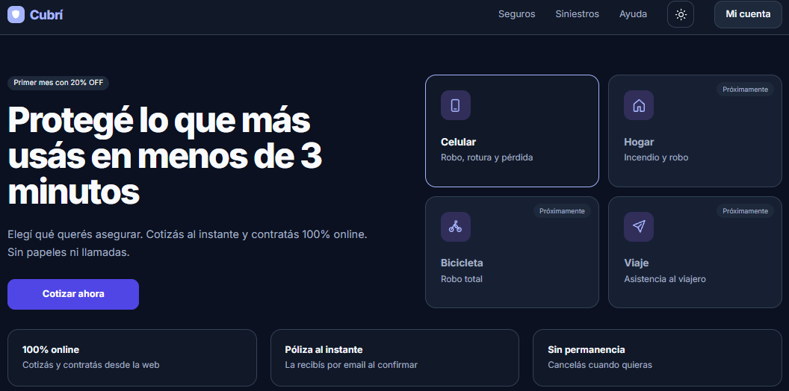
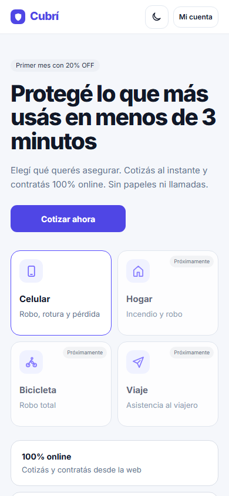

## Cotización
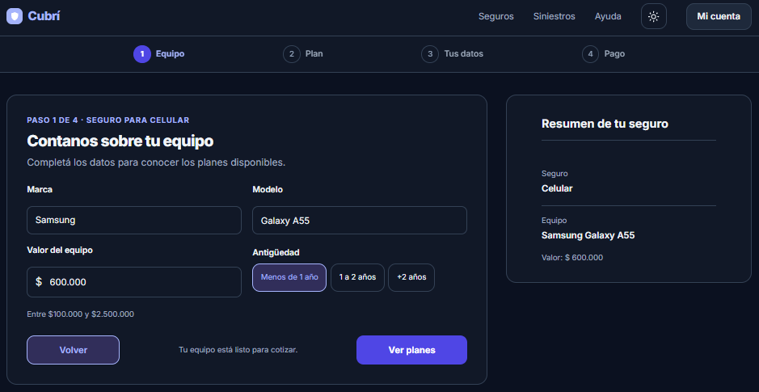
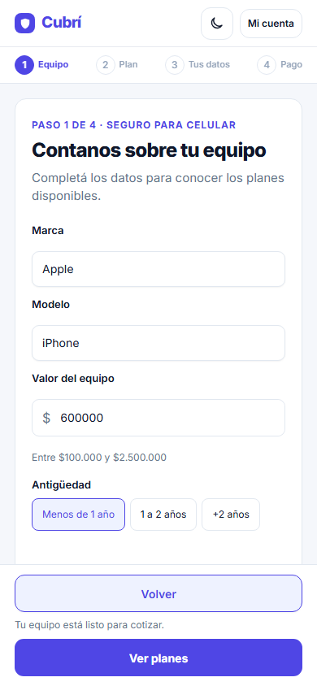

## Planes
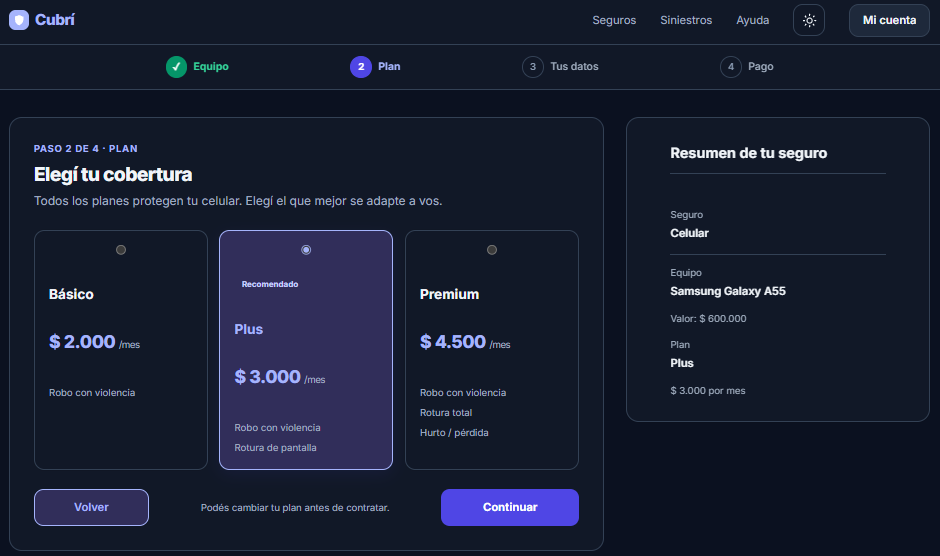
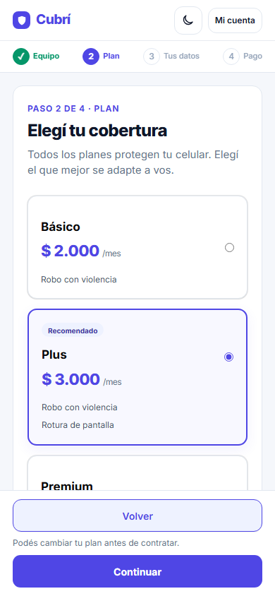

## Datos personales
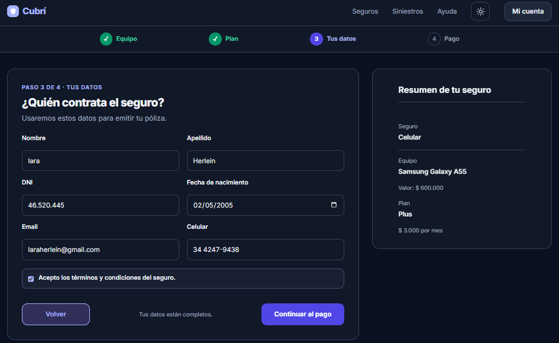
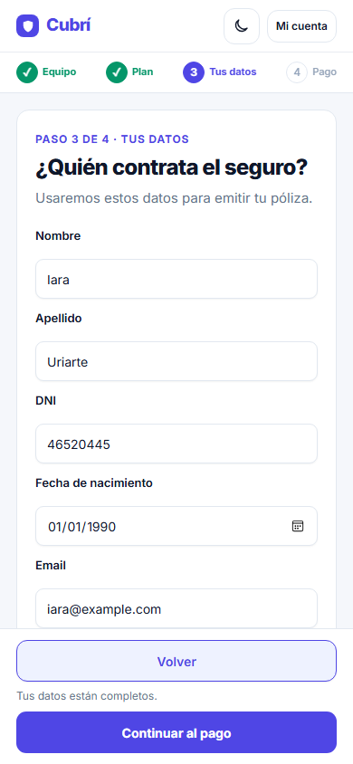

## Pago
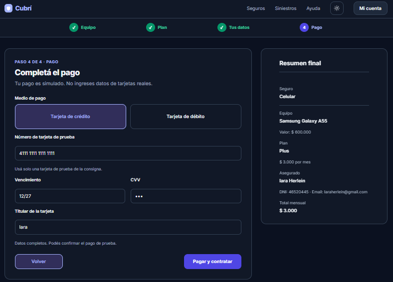
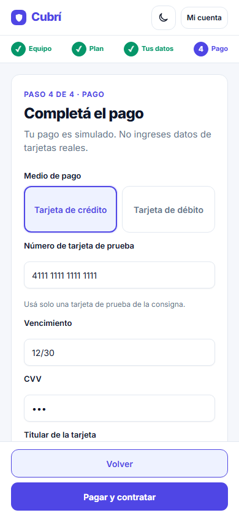

## Éxito
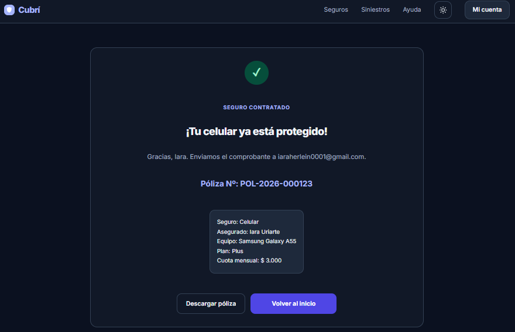
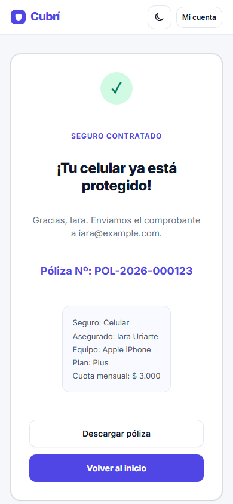

## Error de pago
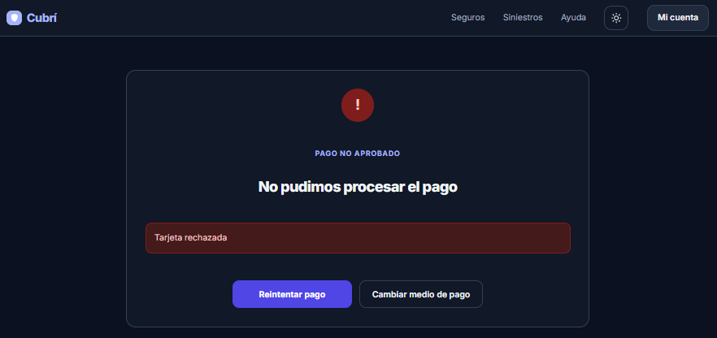
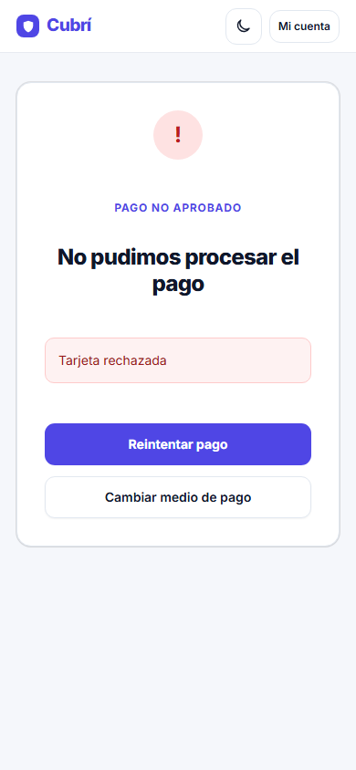

## Decisiones y alcance

- Se mantiene una sola página y se muestran u ocultan las pantallas con `hidden`.
- El resumen se renderiza desde el estado y se adapta a la barra fija mobile o a la tarjeta lateral desktop.
- Se usa Basecoat para botones, tarjetas, badges y avisos; Tailwind para utilidades y el stepper.
- Se implementaron los bonus de descarga de constancia de póliza y selector de modo claro/oscuro.
